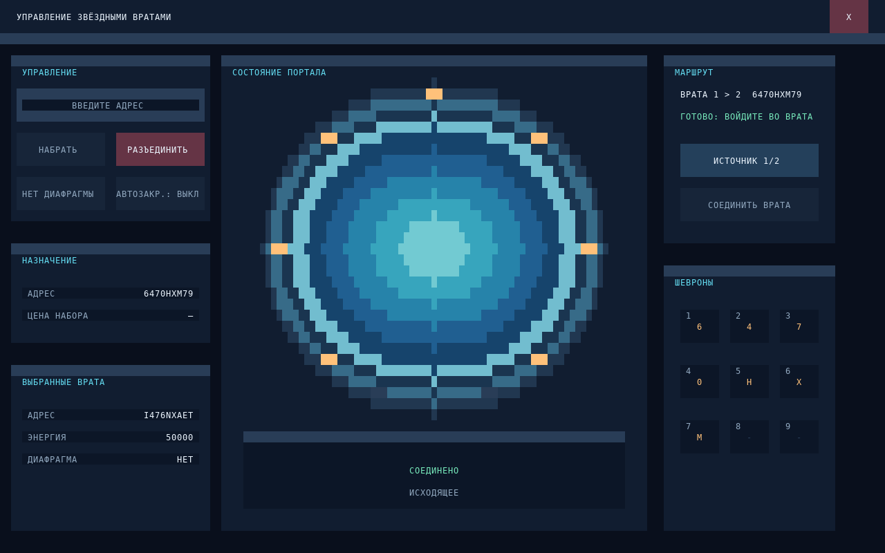

# DiallingComputer

SGC-style Stargate control for Minecraft servers using OpenComputers and a compatible Stargate interface.



## Requirements

- Tier 3 OpenComputers screen and GPU (at least 153 columns by 50 rows)
- OpenComputers computer with OpenOS installed and a keyboard attached to the screen
- An SGCraft OpenComputers Stargate interface (or compatible `stargate` component) for each gate

## Install and run

Copy `StargateControl.lua` and the entire `src` directory into the same directory on the OpenOS filesystem. For example, if you copy them into `/home/DiallingComputer`, run:

```sh
/home/DiallingComputer/StargateControl.lua
```

The program starts from local files, so this installation works without an Internet card. To update it, replace the launcher and the `src` directory together. The bundled `programs.cfg` describes the historical upstream release.

## Controls

- Click the address field and type or paste an address. The field accepts up to nine letters and digits and formats the separators automatically. Press Enter to confirm or Esc to restore the previous address.
- Use **НАБРАТЬ** to connect while the gate is idle. **РАЗЪЕДИНИТЬ** cancels dialling or closes an outgoing connection.
- Use **ОТКР. ДИАФРАГМУ** or **ЗАКР. ДИАФРАГМУ** to operate the iris. **АВТОЗАКР.** closes an open iris when the interface reports an incoming connection.
- Click **X** or press Ctrl+C to exit.

## Link two local gates

1. Build and power both gates. With SGCraft, gates in the same dimension must be in different chunks so each has its own address.
2. Attach an OpenComputers Stargate interface to each gate and connect both interfaces to the same computer network with OpenComputers cables. The computer must be able to see two `stargate` components. Keep the gate and cable chunks loaded.
3. Click **ИСТОЧНИК** to pick the gate you will walk through. The panel displays the other gate's address. With both gates idle, click **СОЕДИНИТЬ ВРАТА**.
4. Wait for **ГОТОВО: ВОЙДИТЕ ВО ВРАТА**, then walk into the source gate in Minecraft. If the panel asks you to check both irises, select the gate with the closed iris and open it when safe, then switch back to the source. **АВТОЗАКР.** and the manual iris controls apply to the selected gate.
5. To initiate travel in the opposite direction, terminate the first connection from its source, wait for both gates to go idle, then switch **ИСТОЧНИК** and link again.

SGCraft handles the actual transfer, including any server restrictions. One-way server configurations allow travel from the initiating gate only. The ready indicator uses the `remoteAddress()` and `irisState()` callbacks on both interfaces.
